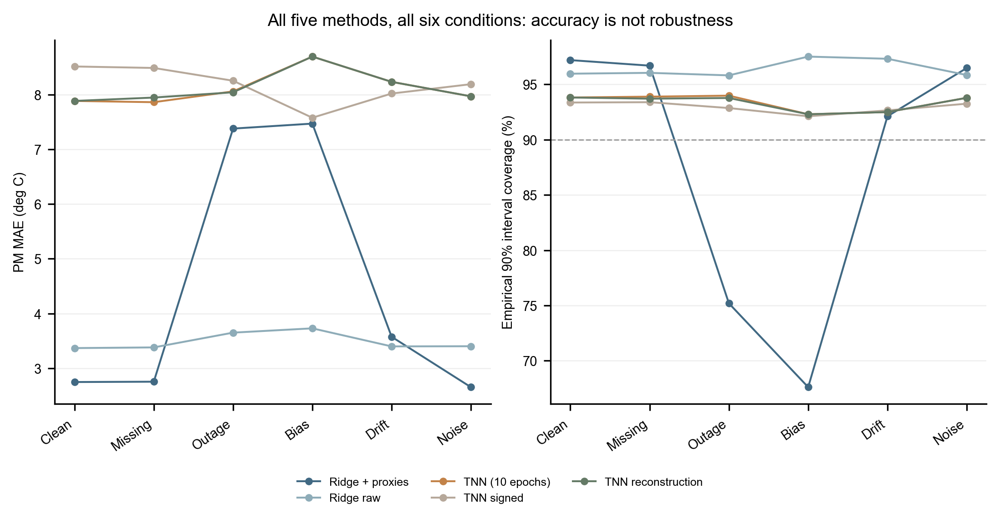

# Thermal Sentinel · PMSM

## Physics-Guided PMSM Temperature Estimation Under Sensor Faults and Unseen Operating Conditions

**Research prototype · v0.1.0 · Python 3.12 · CPU · Public repository**

Project author and maintainer: **StefanUniverse** (developer pseudonym).
No legal name, personal email, affiliation or ORCID is asserted by this alias.

**科研原型，不是工业保护软件。** 本项目研究：完整未见运行工况、未知初始温度和输入传感器异常下，永磁体温度估计何时失效。保留不利结果，不宣称新算法已经胜过原作者TNN、KTNN或工业系统。

**Not an industrial deployment.** This repository makes a complete-profile-isolated experiment reproducible and exposes failure modes rather than claiming universal superiority of physics-guided AI. Sensor faults are simulated on real recordings, not measured field failures.



## 科学问题 / Scientific question

Can physically motivated features or recurrent thermal structure improve PM
temperature estimation without becoming fragile under missing, biased or drifting
inputs? Does empirical interval coverage remain useful on unseen complete
profiles and unknown hot starts?

温度虚拟传感、热网络、Ridge和TNN均为已有方法；本项目贡献是透明的实验组织、传感器压力测试、模型/校准对照、启动失败诊断和交互回放，不是重新发明基础算法。

## 数据与方法 / Data and methods

- [Electric Motor Temperature v3](https://www.kaggle.com/datasets/wkirgsn/electric-motor-temperature): Wilhelm Kirchgässner / Paderborn University LEA, CC BY-SA 4.0; 1,330,816 native rows, 69 profiles, native sampling 2 Hz. Raw data are **not included**.
- Split complete `profile_id` groups **before** sampling or causal feature construction: train 40 / validation 9 / calibration 12 / test 8. Seed 260711. No overlapping cross-profile windows.
- Input: ambient, coolant, u_d, u_q, motor_speed, i_d, i_q. Current measured `pm` and stator temperature labels are **never inference inputs or test-state initializers**. TNN hidden temperatures are predictions, not observed targets.
- All fitted scalers, imputers and reconstruction parameters use training profiles only. Validation selects the TNN checkpoint; calibration profiles determine empirical intervals; test profiles do not select models. Fixed temperature scaling by 200 is a declared constant.
- **10-second replay**: select every 20th native sample independently within each profile; no interpolation. This is not native 2 Hz real-time validation.
- Ridge: raw inputs with causal 60/600/1800 s EWMAs; compare added current/voltage/speed/power **proxies**, not measured physical losses.
- TNN: the original author's MIT `TNNCell`/`DiffEqLayer`, pinned and attributed. Our train-only scaling, no-target initialization, 10-second step and 10-epoch CPU budget differ from the published protocol.
- Ablations: signed conductance/heat parameterization; missing-only i_q reconstruction by polynomial Ridge; empirical interval recalibration. No bias/drift detector is implemented.
- Supplementary effective one-node thermal baseline: ratio parameters only, **not identifiable absolute thermal resistance/capacitance**.

## 已有真实结果 / Recorded reference results

Point-weighted PM MAE in °C over all eight test profiles:

| Method | Clean | Random missing | Sustained outage | Constant bias | Drift | Noise |
|---|---:|---:|---:|---:|---:|---:|
| Ridge, raw + history | 3.37 | 3.38 | 3.65 | 3.73 | 3.40 | 3.40 |
| Ridge, heat proxies + history | 2.75 | 2.76 | 7.38 | 7.47 | 3.58 | 2.66 |
| Author TNN cell, local short-budget protocol | 7.88 | 7.86 | 8.06 | 8.69 | 8.23 | 7.97 |
| TNN signed ablation | 8.51 | 8.48 | 8.25 | 7.58 | 8.02 | 8.19 |
| TNN + missing reconstruction | 7.88 | 7.94 | 8.04 | 8.69 | 8.23 | 7.97 |

These are the frozen reference run, not cherry-picked favourable conditions.
Machine-readable scalar metrics: [all 30 method/scenario rows](reports/metrics.csv),
[all 240 profile rows](reports/profile_metrics.csv), and
[sanitized complete scalar reference](reports/reference_full.json).

主要发现 / Findings:

1. Heat proxies improve clean Ridge MAE but degrade robustness to prolonged
   outage and constant bias. Extra physical-looking features are not automatically safer.
2. The short-budget TNN does not beat Ridge here. Its learning curve is still
   descending; this does **not** reproduce or refute the author's fully trained paper scores.
3. Missing reconstruction has no convincing useful gain; it worsens error inside
   the outage window even when whole-profile error changes slightly.
4. Empirical 90% intervals may be wide and fail under bias. They are not validated
   safety bounds, calibrated probabilities for arbitrary domain shifts, or industrial guarantees.
5. Unknown hot-start profile 46 is a real failure case; its short length makes
   point-weighted averages understate the failure. No measured target is used to hide it.

完整方法、故障幅值、指标和限制见 [docs/METHODS.md](docs/METHODS.md)、
[docs/RESULTS.md](docs/RESULTS.md) 和 [docs/LIMITATIONS.md](docs/LIMITATIONS.md)。

## 安装与复现 / Installation and reproduction

Validated reference platform: Python **3.12.3**, CPU. Use a new environment,
not another project's site-packages. PyTorch is the official CPU wheel.

```bash
python -m venv .venv
# Windows: .venv\Scripts\activate
# Linux/macOS: source .venv/bin/activate
python -m pip install -r requirements.txt
python -m pip install --no-deps --no-build-isolation -e .
```

1. Obtain the original separately licensed data:

```bash
python -m thermal_sentinel.acquire --download
# If Kaggle requires login, download official v3 in your own browser, then:
python -m thermal_sentinel.acquire --source /path/to/official-v3.zip
```

Both ZIP and CSV SHA-256 must match the frozen v3 manifest. No synthetic data
substitute is accepted. The clean-environment verification report records whether
fresh network download or verified local-file acquisition was actually tested.

2. Audit, train and export:

```bash
python -m thermal_sentinel.data
python -m thermal_sentinel.experiment --ridge-only --stride 20
python -m thermal_sentinel.experiment --stride 20 --epochs 10
python -m thermal_sentinel.export
python -m thermal_sentinel.figures --input results/experiment.json --out results/figures
python -m thermal_sentinel.lptn
python -m unittest discover -s tests -v
```

The full run trains TNN and its signed ablation from scratch. No pretrained
weights are shipped. Raw data, all temporal replay, generated checkpoints and
working outputs stay in ignored `data/` and `results/`.

3. Start the interactive local replay:

```bash
python -m thermal_sentinel.demo --port 4382
```

Open **http://127.0.0.1:4382/**. Select profile/model/fault, scrub/play, reveal
measurement, and compare all generated methods. Generate results first; there is
no fabricated bundled time series. The reveal button is a demonstration switch,
not a secrecy boundary. Only allowlisted result files are served on loopback.

Optional browser QA uses the pinned Node Playwright dependency and an installed
Edge or Chrome; see [docs/REPRODUCIBILITY.md](docs/REPRODUCIBILITY.md).

## 结构 / Structure

```text
src/thermal_sentinel/   data protocol, experiments, TNN harness, demo, figures
configs/               fixed protocol and complete-profile split
tests/                 isolation, causality, metrics, model and server checks
reports/               reviewed aggregate metrics and figures; no raw traces
docs/                  methods, data, results, limitations, audits, release gate
third_party/           original TNN MIT notice and pinned provenance
data/                  local raw data only (ignored)
results/               local experiments/replay/weights only (ignored)
```

## 局限性 / Known limitations

One motor/one dataset, one seed and short CPU training budget; reused test
profiles have been examined in exploratory work. No new preregistered external
blind benchmark, real injected hardware fault, second-motor transfer, industrial
deployment, embedded timing, thermal derating control or certified protection.
The replay assumes a 10 s step and unknown initial target state. Absolute LPTN
parameters cannot be identified from unmeasured loss proxies alone. No superiority
over KTNN is claimed. No other motor's data are pooled into this experiment.

## 来源、许可与引用 / Sources, license and citation

Project-original code: **MIT**, copyright 2026 StefanUniverse, authorized by the project
owner. Original TNN classes retain their author's MIT notice; dataset rights are
separate **CC BY-SA 4.0**, not relicensed by this project's MIT license. Raw
third-party data, notebooks, research PDFs, CAD and model weights are excluded.
See [third-party provenance](third_party/PROVENANCE.md),
[sources](docs/SOURCES.md), and [CITATION.cff](CITATION.cff).

Use the repository's citation metadata for this software, and separately cite
the dataset and Kirchgässner, Wallscheid & Böcker's TNN paper,
[doi:10.1016/j.engappai.2022.105537](https://doi.org/10.1016/j.engappai.2022.105537).
No software DOI has been minted for this private preparation snapshot.

**Publication:** Public on 2026-11-07 after the owner's explicit final approval
and [final audit](docs/FINAL_PUBLIC_RELEASE_AUDIT.md). See the
[publication report](docs/FINAL_PUBLIC_RELEASE_REPORT.md) for anonymous-access,
download/clone verification and known limitations. No GitHub Release or PyPI
package is implied by making this repository public.
See [the anonymity audit](ANONYMITY_AUDIT.md) and
[repeatable privacy checks](docs/ANONYMITY.md). A clean file tree does not sanitize
old Git commits; only the separately initialized, history-audited repository is
eligible for a later public-release decision.
